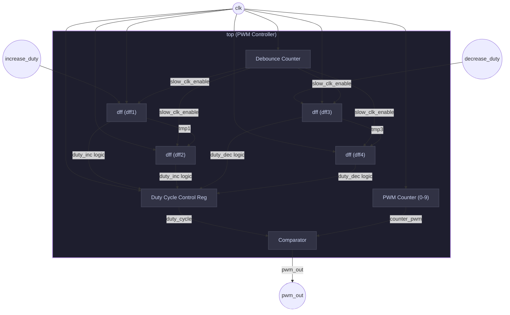

# Button-Controlled Pulse Width Modulation (PWM) Generator

This directory contains the Verilog implementation of an interactive **Pulse Width Modulation (PWM) Generator**. The duty cycle can be stepped up or down in 10% increments using pushbuttons. The module includes button debouncing and edge-detection circuitry to ensure clean, glitch-free duty cycle transitions.

---

## 🏗️ Block Diagram & Architecture

The system consists of a clock divider, synchronized edge-detectors for the pushbuttons, a duty cycle control register, and a comparator-based PWM generator.



---

## 🔌 Port Definitions & Interface

### Top-Level Module (`top`)

| Port Name       | Direction | Bit-Width | Description                                         |
| --------------- | --------- | --------- | --------------------------------------------------- |
| `clk`           | Input     | `1`       | High-speed master system clock.                     |
| `increase_duty` | Input     | `1`       | Pushbutton input to increase the duty cycle by 10%. |
| `decrease_duty` | Input     | `1`       | Pushbutton input to decrease the duty cycle by 10%. |
| `pwm_out`       | Output    | `1`       | Generated Pulse Width Modulated output.             |

### D Flip-Flop Helper (`dff`)

| Port Name | Direction | Bit-Width | Description          |
| --------- | --------- | --------- | -------------------- |
| `clk`     | Input     | `1`       | System Clock.        |
| `en`      | Input     | `1`       | Clock enable signal. |
| `d`       | Input     | `1`       | Data input.          |
| `Q`       | Output    | `1`       | Data output.         |

---

## ⚙️ Operating Principle & Duty Cycle Levels

The PWM output period is determined by `counter_pwm` which counts from `0` to `9` (repeating every 10 clock cycles). The duty cycle control register `duty_cycle` is checked against the counter to decide the output:

```verilog
pwm_out = (counter_pwm < duty_cycle) ? 1'b1 : 1'b0;
```

### Duty Cycle Resolution Table

The duty cycle starts at a default of **50%** (`duty_cycle = 5`) and can be adjusted through 11 distinct levels (0% to 100%):

| `duty_cycle` Value | `counter_pwm` High States | High Ticks / Total Ticks | Resulting Duty Cycle (%) |
| ------------------ | ------------------------- | ------------------------ | ------------------------ |
| `0`                | None                      | $0 / 10$                 | **0%** (Always Low)      |
| `1`                | `0`                       | $1 / 10$                 | **10%**                  |
| `2`                | `0`, `1`                  | $2 / 10$                 | **20%**                  |
| `3`                | `0` to `2`                | $3 / 10$                 | **30%**                  |
| `4`                | `0` to `3`                | $4 / 10$                 | **40%**                  |
| `5`                | `0` to `4`                | $5 / 10$                 | **50%** (Default State)  |
| `6`                | `0` to `5`                | $6 / 10$                 | **60%**                  |
| `7`                | `0` to `6`                | $7 / 10$                 | **70%**                  |
| `8`                | `0` to `7`                | $8 / 10$                 | **80%**                  |
| `9`                | `0` to `8`                | $9 / 10$                 | **90%**                  |
| `10`               | `0` to `9`                | $10 / 10$                | **100%** (Always High)   |

---

## 🛡️ Debounce & Edge-Detection Pipeline

In hardware, mechanical buttons bounce when pressed, producing rapid false high/low transitions. The logic filters and edge-detects button presses through a multi-stage pipeline:

1. **Clock Prescaler / Divider**:

   `counter_debounce` divides the system clock. It resets on `>= 1`, creating an enable tick `slow_clk_enable` every 2 clock cycles.
2. **Two-Stage Shift Registers**:

   Each button input is sampled through two cascaded D Flip-Flops enabled by `slow_clk_enable`:
   - `increase_duty` is sampled into `tmp1` and then shifted into `tmp2`.
   - `decrease_duty` is sampled into `tmp3` and then shifted into `tmp4`.
3. **Rising-Edge Generation**:

   ```verilog

duty_inc = tmp1 & (~tmp2) & slow_clk_enable;
duty_dec = tmp3 & (~tmp4) & slow_clk_enable;
```

This pulse ensures that holding down a button does not continuously increment or decrement the duty cycle; only a new button press triggers a change.
